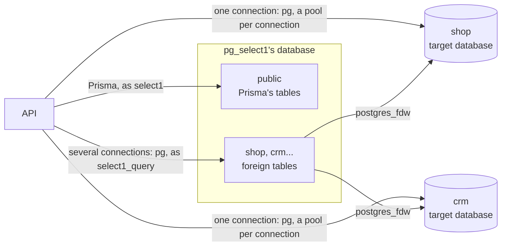

# How queries reach your databases

Every query, saved query and alert names its **connections**, one or more, picked in the editor. How it runs depends on how many:

- **One connection**: the API runs it directly on that database with `pg`. It's a plain proxy, so SQL written for that database works as it is.
- **Two or more**: it runs in pg_select1's own database, on postgres_fdw foreign tables that stand for each connection's tables. That database joins the rows the targets send.

postgres_fdw is used only for a query that needs it. Where pg_select1's database doesn't have postgres_fdw, queries across connections are off, and everything else still works.

> **Status:** mostly spec. Built so far, on the direct path only: a pool per connection (`apps/backend/src/targets.ts`), and in the `explore` module table browsing, which lists a connection's tables, reads up to 200 rows of one and describes how one is made from the target's `pg_catalog` (its columns, constraints, indexes, triggers, the foreign keys that refer to it, a view's definition and a partitioned table's partitions), and running one SQL statement on one connection from the explorer (picking a table with no SQL written runs `select * from` it), through a cursor, 200 rows at a time. The explorer asks for the next 200 as the person scrolls near the last row, up to 10,000: each page runs the statement again and skips the rows before it through the cursor, with `synchronize_seqscans` off so a big table's scan starts in the same place each time. So a page follows the last one exactly only when the statement has an `ORDER BY` and the data hasn't changed in between. The SQL editor completes each connection's tables, views, materialized views, functions and columns from a catalog the API keeps in memory (`explore/catalog.ts`), read from every connection's `pg_catalog` as it starts and every 15 minutes by a pg-boss job, whenever the explorer lists a connection's tables, and on first use for a connection added or changed since. All three run in a `READ ONLY` transaction with a 30-second `statement_timeout`. A run is cancelled by the id the browser gives it (`POST /api/explore/queries/:runId/cancel`), not by the browser dropping the request, which Bun's HTTP server doesn't report once it has read the body. Saved queries (the `query` module) keep their connections in `saved_query_connections`, first one first, and the API takes one for now. Writes on writable connections and everything across connections aren't built yet.



## Which path a query takes

| Connections | Runs                                                               | SQL                                                                                                         |
| ----------- | ------------------------------------------------------------------ | ----------------------------------------------------------------------------------------------------------- |
| One         | Directly on the target, from that connection's pool in the API     | As you'd write it against that database: `select * from orders`                                             |
| Two or more | In pg_select1's database, as `select1_query`, through postgres_fdw | The first connection's tables need no prefix; the others are reached through their schemas: `crm.customers` |

The path comes from the connections the query lists, never from parsing its SQL. A target can have a schema of its own called `crm`, so `crm.customers` alone doesn't say which database it means. The editor helps instead. When a one-connection query fails because schema `crm` doesn't exist and `crm` is a connection, it offers to add `crm` to the query. It always shows which path a query runs on.

Adding a second connection changes a few things for the first one's SQL (see [What a query across connections doesn't get](#what-a-query-across-connections-doesnt-get)). Its other schemas are renamed, so `billing.invoices` becomes `shop__billing.invoices`. And the target's own functions are no longer there.

## One connection: directly on the target

- **Pools**: the API keeps a small `pg` pool for each connection, opened on first use and closed when idle. It decrypts the connection's credentials only to open it, and connects with `application_name = 'pg_select1'`.
- **Each run**: begins a `READ ONLY` transaction, unless the person runs the query as a write on a writable connection and their role allows it. It sets `statement_timeout` with `SET LOCAL`. It runs the SQL as one statement with the extended protocol, so a run can't hold several statements, and reads the rows through a cursor, up to the row cap, with each column's type. Then it rolls back a read and commits a write.
- **Cancel**: `pg_cancel_backend(pid)` on the target, from another connection in the same pool, since a role may cancel its own backends.
- **Everything else on a connection** takes this path too. The explorer's schema look-ups query the target's `pg_catalog`. Table browsing, the connection test and alerts on one connection all run directly.

## Two or more connections: through postgres_fdw

### Requirements

- **postgres_fdw in pg_select1's database**. It ships with Postgres in contrib, so the official Docker images, Homebrew and Postgres.app have it, and so do most managed Postgres services. Render's managed Postgres, Heroku's Essential plans and Aurora DSQL don't. The extension isn't trusted, so creating it takes a superuser, or the managed equivalent such as `rds_superuser`. If the API's role is neither, an admin creates the extension once and grants that role `USAGE ON FOREIGN DATA WRAPPER postgres_fdw`.
- **`CREATEROLE` for the API's role** (`select1`), so it can create `select1_query`.
- **A start-up check, not a migration.** At start-up the API runs `CREATE EXTENSION IF NOT EXISTS postgres_fdw`. Then it creates a foreign server in a transaction it rolls back, and creates `select1_query` or updates its password. If any step fails, queries across connections are off. `/health` and the editor say what's missing, such as "postgres_fdw isn't installed, and select1 can't install it: run `CREATE EXTENSION postgres_fdw` as a superuser". A migration would fail the whole install on hosts without the extension.
- **Network**: postgres_fdw connects to a target from pg_select1's database server, not from the API. So that server must reach each target too. When it sees a target at another address than the API does, such as a Docker service name, the connection's **address from pg_select1's database** (host and port) says where. It defaults to the connection's own host and port.
- **Targets**: the connection's role must log in with a password (`scram-sha-256` or `md5`), because postgres_fdw refuses a non-superuser's mapping when the server doesn't ask for one (`trust`).

### Names

A connection's **name** is the prefix of everything pg_select1 creates for it, and of the schemas people write in queries across connections. It uses lowercase letters, digits and `_`, starts with a letter, has no `__`, doesn't start with `pg_` (Postgres reserves those schema names), is at most 40 characters and is unique.

| Target               | In pg_select1's database |
| -------------------- | ------------------------ |
| the database         | foreign server `<name>`  |
| schema `public`      | schema `<name>`          |
| any other schema `s` | schema `<name>__s`       |

A schema name longer than Postgres's 63 bytes is cut short and gets a hash suffix. Roles are named `select1` and `select1_query`, never `pg_select1`, because Postgres reserves role names that start with `pg_` too.

### Setting up a connection

A connection gets its foreign server the first time a query across connections lists it, not when it's created. The `connection` module sets it up as `select1`, in one transaction:

| Object         | What                                                                                                                                                                                                                                                                                                        |
| -------------- | ----------------------------------------------------------------------------------------------------------------------------------------------------------------------------------------------------------------------------------------------------------------------------------------------------------- |
| Foreign server | The address from pg_select1's database, `dbname`, `sslmode`, `application_name 'pg_select1'`, `fetch_size`, and `extensions`, listing the extensions installed on both sides so that their operators are pushed down. On a read-only connection it also sets `updatable 'false'` and `truncatable 'false'`. |
| User mapping   | For `select1_query`, with the target role's user and password.                                                                                                                                                                                                                                              |
| Foreign tables | One for each table, view, materialized view and partitioned table in the target's schemas (not for each partition). The connection's `schemas` setting limits which schemas; by default, all non-system ones.                                                                                               |
| Grants         | `select1_query` gets `USAGE` on the connection's schemas and `SELECT` on their foreign tables. On a writable connection it gets `INSERT`, `UPDATE` and `DELETE` too.                                                                                                                                        |

The module doesn't use `IMPORT FOREIGN SCHEMA`, because it fails on the first column whose type pg_select1's database doesn't have. Instead the API reads the target's catalog over the direct path and creates each foreign table itself:

- A column of a built-in type, or of a type from an extension installed on both sides, keeps its type.
- A column of one of the target's own types gets a stand-in in the connection's schema: an enum with the same labels, a domain's base type, or a composite with the same fields. A column of any other type becomes a stand-in over `text`. Its values read correctly, but filters on it run in pg_select1's database instead of on the target.

The foreign tables are a copy of the target's tables at one moment. They're rebuilt in one transaction at three times: on a pg-boss schedule (hourly by default), when someone clicks **Refresh schema** in the explorer, and when a query fails because a foreign table no longer matches its target (the target answers with an undefined table or column). In that last case the editor offers to run the query again; it never re-runs it by itself. Deleting the connection, or taking it out of queries across connections in its settings, runs `DROP SERVER ... CASCADE` and drops its schemas. That also removes the user mapping's plain copy of its password.

### Running a query across connections

pg_select1's database has two login roles:

| Role            | Connects with                                                                                            | Can                                                                                                                                                                                                |
| --------------- | -------------------------------------------------------------------------------------------------------- | -------------------------------------------------------------------------------------------------------------------------------------------------------------------------------------------------- |
| `select1`       | `DATABASE_URL`                                                                                           | Owns everything: Prisma's tables in `public`, pg-boss's in `pgboss`, and the foreign servers, mappings and schemas. Never runs a person's SQL.                                                     |
| `select1_query` | Its own pool. The start-up check creates the role, with a password derived from `PG_SELECT1_SECRET_KEY`. | Read the connections' foreign tables, and write those of writable connections. No privileges on `public` or `pgboss`, so a query can't read pg_select1's users, sessions or encrypted credentials. |

`select1_query` is a separate login, not a `SET ROLE` on `select1`'s connection. A query could switch back with `RESET ROLE` or `set_config('role', ...)`.

A run works like a direct one: a transaction that is `READ ONLY` unless it's an allowed write, `statement_timeout`, one statement, a cursor up to the row cap. On top of that, `SET LOCAL search_path` puts the first connection's schemas first:

```sql
-- connections: shop, crm
select o.id, o.total, c.email
from orders o
join crm.customers c on c.id = o.customer_id
where o.created_at > now() - interval '1 day';
```

Each target filters its own rows where it can and sends them to pg_select1's database, which joins them. postgres_fdw pushes `WHERE`, joins, aggregates, `ORDER BY` and `LIMIT` down to a target when they touch only that target's tables and use only built-in functions and operators, or those of the server's `extensions`. That's quick for selective queries and slow for big ones; the statement timeout and the row cap bound it. `EXPLAIN VERBOSE` shows the SQL each target is sent, in its `Foreign Scan` nodes.

### What a query across connections doesn't get

- **The targets' own functions, procedures, sequences and types**, apart from the stand-in types. Built-in functions work, run on whichever side postgres_fdw picks.
- **The targets' own schema names**: they're prefixed, as in [Names](#names).
- **The targets' plans**: `EXPLAIN` shows pg_select1's plan.
- **Your session settings on the targets**: postgres_fdw sets each target's session to `search_path = pg_catalog`, UTC and ISO dates. Values come back in pg_select1's session time zone.
- **Atomic writes across connections**: postgres_fdw commits each target separately at the end of the transaction, without two-phase commit.

## Safety

How each rule in `AGENTS.md` holds on each path:

| Rule                    | One connection                                                                                                                       | Two or more                                                                                                                                                                                                                                                                                                                                                                                   |
| ----------------------- | ------------------------------------------------------------------------------------------------------------------------------------ | --------------------------------------------------------------------------------------------------------------------------------------------------------------------------------------------------------------------------------------------------------------------------------------------------------------------------------------------------------------------------------------------- |
| Read-only by default    | A `READ ONLY` transaction on the target.                                                                                             | Three layers: the `READ ONLY` transaction rejects writes to foreign tables, a read-only connection's server has `updatable 'false'` and `truncatable 'false'`, and `select1_query` has only `SELECT` on its foreign tables.                                                                                                                                                                   |
| `statement_timeout`     | Set on the target's session.                                                                                                         | Set in pg_select1's session. When it fires, postgres_fdw cancels the query on each target.                                                                                                                                                                                                                                                                                                    |
| Row cap                 | The cursor stops at the cap.                                                                                                         | The cursor stops at the cap. postgres_fdw reads from each target `fetch_size` rows at a time, so the targets stop being read soon after.                                                                                                                                                                                                                                                      |
| Cancel                  | `pg_cancel_backend` on the target.                                                                                                   | `pg_cancel_backend` from another `select1_query` connection. postgres_fdw passes the cancel on to the targets.                                                                                                                                                                                                                                                                                |
| Credentials stay secret | Encrypted in the `connection` table (AES-GCM, under `PG_SELECT1_SECRET_KEY`), and decrypted only in the API's memory to open a pool. | The same, plus a plain copy in the user mapping, in Postgres's catalog (`pg_user_mapping`), for each connection used across connections. Superusers and `select1` can read it, and it's in a `pg_dump` of the database. `select1_query` can't, because it never gets `USAGE` on a foreign server. So treat pg_select1's database and its backups as secret once you query across connections. |
| Connections to targets  | At most the pool's size per connection, from the API's host.                                                                         | One for each backend of `select1_query`'s pool that has used the target, open for that backend's life, from the host of pg_select1's database.                                                                                                                                                                                                                                                |

Whatever the path, give each connection a target role with only the privileges it needs, read-only for a read-only connection, and its own `statement_timeout` as a backstop.

## Explorer, alerts and tests

- **Explorer**: always the direct path. Schemas, tables, columns, indexes, constraints and comments come from the target's `pg_catalog`, and browsing a table queries it.
- **Alerts**: pg-boss runs them on their schedules, on the path their connections call for, with the same limits. So an alert can compare databases, such as paid orders in `shop` that have no invoice in `billing`.
- **Tests**: backend tests start pg_select1's database and the target databases as Testcontainers. The direct path reaches a target on its mapped port. Queries across connections reach it through its alias on a Docker network shared with pg_select1's database, which is the connection's address from pg_select1's database. Both paths are tested on every run.

## Open questions

- **Stand-in types**: check that postgres_fdw never pushes a filter on a stand-in column down to the target, which would send it something like `enum = text`, and decide how arrays of the target's own types map.
- **Access per connection**: for now everyone signed in can query every connection. Limiting that would take a check in the API on the direct path, and a role in pg_select1's database for each person or connection on the other.
- **Big targets**: with thousands of tables, building the foreign tables takes time. That may call for building one schema at a time, when a query across connections first uses it.
