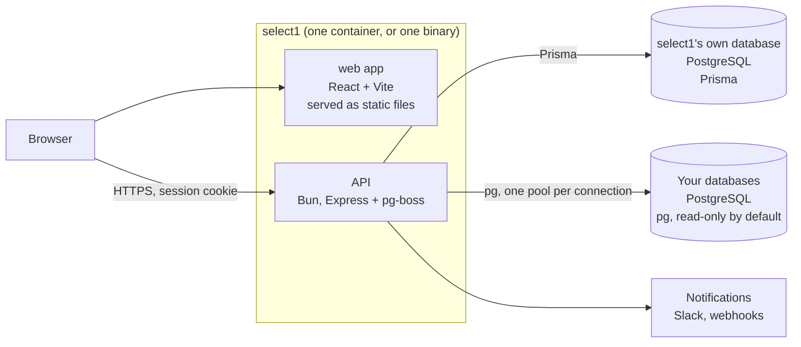

# Stack

Every language, tool, library, service and approach select1 uses, and where each lives. select1 is an open-source tool people run themselves, on a laptop or a server, so it needs nothing but Postgres to run.

> **Status:** the skeleton is in place: the workspaces, tooling, local stack, Docker image and executable, with a health check end to end. Modules and files that don't exist yet are listed where they will go. Not set up yet: the sample target Postgres (it comes with the explorer) and the Claude Code `Stop` hook.

## At a glance



Two kinds of database, kept apart throughout:

- **select1's own database** holds its users, connections, saved queries, alerts, alert runs and pg-boss's jobs. Prisma owns it.
- **Your databases** are the ones people explore and alert on. select1 never migrates or writes to them unless a connection is explicitly marked writable, and it reaches them with plain `pg`, never Prisma.

## Languages

| What                   | Where                                                                                                                                                                                  |
| ---------------------- | -------------------------------------------------------------------------------------------------------------------------------------------------------------------------------------- |
| TypeScript (7, strict) | Everything: apps, shared package, tests, stories, config, and the Prisma schema (`apps/backend/src/prisma/contract.ts`). `noUncheckedIndexedAccess` and `verbatimModuleSyntax` are on. |
| TSX (React)            | The web app.                                                                                                                                                                           |
| SQL                    | Migrations in `apps/backend/migrations/`, the catalog queries that introspect target databases, test fixtures.                                                                         |
| CSS (Tailwind v4)      | `apps/web/src/index.css`: the theme, with no `tailwind.config`.                                                                                                                        |
| Markdown + Mermaid     | `docs/`, `README.md`, `AGENTS.md`, and the agent skills.                                                                                                                               |
| YAML                   | `compose.yaml` (local stack, and the example for self-hosting) and the GitHub Actions workflows.                                                                                       |

## Runtime, packages and the monorepo

- **Bun**: the runtime for the API, scripts and tests, and the package manager (`bun install`, `bun add`, `bun run`; never npm, yarn or pnpm). `bun.lock` is committed.
- **Bun workspaces**: `apps/*` are shipped, `packages/*` are imported. `bun --filter` runs a script in one or all of them.
- **`bun build --compile`**: builds select1 into a single executable with the web app embedded, for running on a laptop without Docker.

## Repo structure

```
apps/backend     Express API, jobs, alert evaluation, notifications, the Prisma contract and migrations
apps/web         The web app: explorer, SQL editor, saved queries, alerts, settings
packages/shared  Zod schemas, types and product constants shared by both apps
docs/            This page, architecture notes and ideas
.agents/         Skills and subagents for AI coding agents, linked from .claude/
```

There's no separate admin UI or landing page: managing users and connections is part of the web app, behind an admin role, and the README is the landing page until there's a docs site.

### `packages/shared`

One `src/index.ts` of Zod schemas for every request and response, the types inferred from them, and the product's constants (alert conditions, channel kinds, limits...). It exports TypeScript source, so there's no build step: the backend and the web app import it directly.

### Backend modules

The API is split by product area into modules in `apps/backend/src/modules/<name>/`. They share one Prisma contract and one Postgres schema (`public`) in select1's database:

| Module       | What it holds                                                                                                 |
| ------------ | ------------------------------------------------------------------------------------------------------------- |
| `user`       | Accounts, sessions, roles (admin, editor, viewer), settings                                                   |
| `connection` | Connections to target databases, their encrypted credentials, read-only and limits settings, connection tests |
| `explore`    | Schema introspection (schemas, tables, columns, indexes, constraints), table browsing, ad-hoc queries         |
| `query`      | Saved queries, their history and last results                                                                 |
| `alert`      | Alerts, their schedules and conditions, alert runs, the ok → triggered → resolved state                       |
| `notify`     | Notification channels (Slack, webhook), deliveries and their retries                                          |

Each module has the same shape: `api.ts` (its `endpoints` list), `service.ts` (the logic), `jobs.ts` (its background jobs), and tests next to each file. `modules/index.ts` registers them all. Shared plumbing sits in `src/`: `app.ts` (the Express app), `api.ts` (starts the workers and serves, the web app included), `endpoint.ts`, `auth.ts`, `job.ts`, `crypto.ts`, `targets.ts` (the pools to target databases), `db.ts`.

### Web app areas

`apps/web/src/` keeps the app's shell at the root (`main.tsx`, `App.tsx`, `router.tsx`, `ui.tsx`) and everything else in a folder per product area: `explore/`, `editor/`, `queries/`, `alerts/`, `connections/`, `settings/`, and `lib/` for what every area uses. shadcn/ui's components are in `components/ui/`.

## Backend

| Tool                   | Used for                                                                                                                                                                                                                                                                                                                                                                                                 |
| ---------------------- | -------------------------------------------------------------------------------------------------------------------------------------------------------------------------------------------------------------------------------------------------------------------------------------------------------------------------------------------------------------------------------------------------------- |
| **Express 5**          | The HTTP API, and serving the web app's build. Routes are declared in `endpoints` lists, which apply the sign-in and role guards.                                                                                                                                                                                                                                                                        |
| **Zod 4**              | Validating every request (`parseRequest()`) against `packages/shared`'s schemas.                                                                                                                                                                                                                                                                                                                         |
| **Prisma 8** (RC)      | ORM and migrations for select1's own database. The schema is TypeScript: one `src/prisma/contract.ts` built with `defineContract` (`@prisma/orm-postgres/contract-builder`). `prisma contract emit` writes `contract.json` and `contract.d.ts` into `src/prisma/generated/`; `prisma migration plan` writes a migration and `prisma db migrate` applies it. On the release candidate until 8.0.0 is out. |
| **PostgreSQL**         | select1's own database (17 locally; Prisma 8 needs 15 or later), all in the `public` schema.                                                                                                                                                                                                                                                                                                             |
| **pg** (node-postgres) | Talking to target databases: one pool per connection, with `statement_timeout`, read-only transactions and column type metadata.                                                                                                                                                                                                                                                                         |
| **pg-boss**            | Running alerts on their schedules, sending notifications with retries, and housekeeping, stored in Postgres and run in the API process.                                                                                                                                                                                                                                                                  |
| **Better Auth**        | Accounts and sessions in select1's own database, with email and password, and OIDC for single sign-on on a server.                                                                                                                                                                                                                                                                                       |
| **Web Crypto**         | Encrypting connection credentials at rest with AES-GCM, under a key from `SELECT1_SECRET_KEY`.                                                                                                                                                                                                                                                                                                           |

## Frontend

The web app is a single-page app:

| Tool                                                       | Used for                                                                                      |
| ---------------------------------------------------------- | --------------------------------------------------------------------------------------------- |
| **React 19**                                               | UI.                                                                                           |
| **Vite 8**                                                 | Dev server and build, with `@vitejs/plugin-react` and `@tailwindcss/vite`.                    |
| **Tailwind CSS v4**                                        | Styling, themed in `src/index.css`, light and dark.                                           |
| **shadcn/ui**                                              | Components, copied into `components/ui/` and kept close to stock, on **Radix UI** primitives. |
| **CodeMirror 6** + `@codemirror/lang-sql`                  | The SQL editor, with autocomplete fed by the connection's schema.                             |
| **TanStack Table** + **TanStack Virtual**                  | Result grids and table browsing, virtualized so large results scroll smoothly.                |
| **cmdk**                                                   | The command palette and searchable pickers (tables, connections, saved queries).              |
| **lucide-react**                                           | Icons.                                                                                        |
| **Fontsource**                                             | Self-hosted Geist and Geist Mono, so nothing loads from Google.                               |
| **class-variance-authority**, **clsx**, **tailwind-merge** | Component variants and `cn()`.                                                                |
| A small History API router                                 | `src/router.tsx`, with the connection, table and filters in the URL. No routing library.      |

The web app is served by the API on the same origin, so there's no CORS and sign-in is a session cookie.

### Colors

Black, white and greys, with a chartreuse yellow for small marks and green for things that are fine. The theme is shadcn/ui's neutral one, as CSS variables in `apps/web/src/index.css`, light and dark.

| Color                      | Light                                   | Dark                                     | Used for                                                                                                            |
| -------------------------- | --------------------------------------- | ---------------------------------------- | ------------------------------------------------------------------------------------------------------------------- |
| Background                 | `#ffffff`                               | `#0a0a0a` (`oklch(0.145 0 0)`)           | The page.                                                                                                           |
| Foreground                 | `#0a0a0a` (`oklch(0.145 0 0)`)          | `#fafafa` (`oklch(0.985 0 0)`)           | Text.                                                                                                               |
| Primary                    | `#171717` (`oklch(0.205 0 0)`)          | `#e5e5e5` (`oklch(0.922 0 0)`)           | Main buttons.                                                                                                       |
| Muted, secondary, accent   | `#f5f5f5` (`oklch(0.97 0 0)`)           | `#262626` (`oklch(0.269 0 0)`)           | Quiet backgrounds, hovered items.                                                                                   |
| Muted foreground           | `#737373` (`oklch(0.556 0 0)`)          | `#a1a1a1` (`oklch(0.708 0 0)`)           | Secondary text.                                                                                                     |
| Border, input              | `#e5e5e5` (`oklch(0.922 0 0)`)          | white at 10% / 15%                       | Lines and fields.                                                                                                   |
| Slate grey                 | `#5c5f66`                               | `#5c5f66`                                | The second half of the wordmark.                                                                                    |
| **Highlight** (chartreuse) | `#e8f04a`                               | `#e8f04a`                                | Small marks only: the current page, dots, step numbers, pills. Always black text on it, never yellow text on white. |
| **Success** (green)        | `#16a34a` (`oklch(0.627 0.17 149.214)`) | `#22c55e` (`oklch(0.723 0.192 149.579)`) | Things that are fine: an alert that's ok or resolved, a connection that works.                                      |
| Destructive (red)          | `oklch(0.577 0.245 27.325)`             | `oklch(0.704 0.191 22.216)`              | Errors, a triggered alert, deleting.                                                                                |

No other accents: no blue links, no gold. shadcn's `accent` is the grey of hovered items, not a brand color.

## Code quality

| Tool                     | Command                           | What it does                                                                                                                   |
| ------------------------ | --------------------------------- | ------------------------------------------------------------------------------------------------------------------------------ |
| **TypeScript** (`tsc`)   | `bun run typecheck`               | Type-checks every workspace, tests and stories included.                                                                       |
| **oxlint**               | `bun run lint` / `lint:fix`       | Linting (`.oxlintrc.json`): typescript-eslint's strict and stylistic type-checked rules, React hooks, jsx-a11y, import cycles. |
| **oxlint-tsgolint**      | (part of `lint`)                  | Runs oxlint's type-aware rules on the TypeScript Go compiler.                                                                  |
| **oxfmt**                | `bun run format` / `format:check` | Formatting (`.oxfmtrc.json`): 100 columns, sorted imports, sorted Tailwind classes.                                            |
| All of the above + tests | `bun run check`                   | What CI and `create-pr` run before a PR is merged.                                                                             |

Conventions on top: a `/** */` doc comment on every export, lint rules disabled only line by line with a reason, and migrations named for what they change, e.g. `add_alert_channels`.

## Tests

| Tool                                 | Used for                                                                                                            |
| ------------------------------------ | ------------------------------------------------------------------------------------------------------------------- |
| **Bun's test runner**                | Every workspace's tests, `*.test.ts(x)` next to the code.                                                           |
| **Testcontainers**                   | Throwaway Postgres containers per backend test run: one as select1's database, and seeded ones as target databases. |
| **MSW** (Mock Service Worker)        | Intercepting all outgoing HTTP in tests and Storybook (Slack, webhooks); an unhandled request fails the test.       |
| Fakes in `apps/*/test/`              | A clock for driving alert schedules.                                                                                |
| **Testing Library** + **user-event** | Rendering the whole web app at a path and using it by role and label.                                               |
| **happy-dom**                        | The DOM for the web app's tests.                                                                                    |

Backend tests are integration tests over HTTP (`request()` from `test/api.ts`), against real Postgres for both kinds of database; the web app's logic without React has plain unit tests.

## Storybook

- **Storybook 10** (`apps/web/.storybook/`): the web app's components and pages, in CSF Next, on the app's own Vite config. Addons: docs, a11y, themes (light and dark), and `msw-storybook-addon`, so it reuses the tests' API fixtures and needs no API. `bun run build:storybook` makes a static build in `apps/web/storybook-static`.

## Local development

- **Docker** and **Docker Compose** (`compose.yaml`, `Dockerfile.dev`): `bun run up` starts select1's Postgres and a sample target Postgres seeded with demo data, runs migrations, then the API, web app and Storybook with hot reload through `docker compose watch`.
- **pgweb** (temporary): browses and queries select1's own database on 8091 until select1's explorer can. Then it's removed, and the stack uses select1 itself, with its own database added as a read-only connection.
- A **Claude Code `Stop` hook** (`.claude/settings.json`) applies new migrations to the stack's database after each reply.

| Service                 | Port |
| ----------------------- | ---- |
| select1's Postgres      | 5440 |
| Sample target Postgres  | 5441 |
| API (and built web app) | 3100 |
| Web (Vite dev server)   | 5180 |
| Storybook               | 6016 |
| pgweb (temporary)       | 8091 |

## Distribution

select1 isn't a hosted service: people run it. Releases come from GitHub Actions on a version tag:

| Artifact               | What                                                                                                                                                      |
| ---------------------- | --------------------------------------------------------------------------------------------------------------------------------------------------------- |
| Docker image           | `ghcr.io/<org>/select1`, from `apps/backend/Dockerfile` (`oven/bun` slim) with the web app built in. Runs migrations on start; health check on `/health`. |
| Executables            | `bun build --compile` for macOS and Linux (arm64 and x64), attached to the GitHub release.                                                                |
| `compose.yaml` example | select1 plus its Postgres, in the README, for running it on a server.                                                                                     |

Settings come from environment variables (`DATABASE_URL`, `SELECT1_SECRET_KEY`, `SELECT1_AUTH`...), read and validated by one Zod schema at start-up.

## Third-party services

None are required: select1 runs with only Postgres.

| Service            | Used for                                                                                   |
| ------------------ | ------------------------------------------------------------------------------------------ |
| **Slack**          | Alert notifications, through incoming webhooks.                                            |
| **Webhooks**       | Alert notifications to anything else (PagerDuty, Opsgenie, Discord, your own endpoint).    |
| **OIDC providers** | Optional single sign-on (Google, GitHub, Okta...), through Better Auth.                    |
| **GitHub**         | The repo, issues, pull requests, Actions and the container registry, through the `gh` CLI. |

## Approaches

- **Modular monolith**: one API, one database and one Prisma contract, with the code split into modules by product area, each with its own endpoints and jobs.
- **One process, one origin**: the API serves the web app's build, so running select1 means running one thing, in a container or as a binary.
- **Shared API schemas**: Zod schemas in `packages/shared` validate requests on the API and type responses in the web app.
- **Jobs in Postgres**: pg-boss keeps jobs and schedules in select1's database, so there's no Redis or queue service. Handlers are safe to run twice.
- **Safe by default on target databases**: every connection is read-only unless marked otherwise; queries run in `READ ONLY` transactions with a `statement_timeout` and a row cap; long queries can be cancelled with `pg_cancel_backend`.
- **Never Prisma on target databases**: they're arbitrary schemas, so the `explore` and `alert` modules use `pg` and SQL against `pg_catalog` and `information_schema`.
- **Credentials encrypted at rest**: passwords and connection strings are never stored or logged in plain text, and never sent back to the browser.
- **Alerts notify on change, not on every run**: an alert notifies when it goes from ok to triggered and again when it resolves, so a broken table doesn't page you every minute.
- **Append-only history**: alert runs and notification deliveries are only ever added.
- **Polling, not push**: the web app polls for running queries and alert state; there are no WebSockets.
- **Integration tests over mocks of our own code**: backend tests hit real Postgres over HTTP; only external services are faked.
- **Permissive dependencies only**: select1 is Apache 2.0, so every dependency is MIT, BSD, ISC or Apache.
- **Design in code**: UI is prototyped in the app or standalone HTML, with Storybook for components; no Figma.
- **AI agents**: `AGENTS.md` (imported by `CLAUDE.md`) holds the rules; `.agents/` holds the `create-pr` skill and the `code-reviewer` subagent.

## Editors and docs

- **Zed** for editing and previewing these docs' Mermaid diagrams; any editor with a TypeScript language server works.
- **Mermaid** for diagrams in `docs/`, also drawn by GitHub and [mermaid.live](https://mermaid.live).
